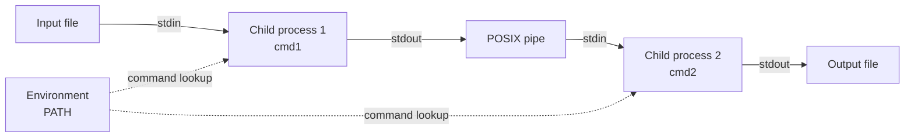

# Pipex

A Unix process-pipeline implementation written in C for the 42 curriculum. `pipex` reproduces the core behavior of shell redirection and pipelines by connecting commands through POSIX pipes, processes, file descriptors, and `execve`.

The project includes the mandatory two-command pipeline and a bonus implementation supporting multiple commands and `here_doc` input.

## Features

- Connects two commands through a Unix pipe in the mandatory implementation.
- Resolves commands from the `PATH` environment variable.
- Supports executable paths such as `./program`.
- Opens input files for reading and output files for truncating writes.
- Uses `fork`, `pipe`, `dup2`, `open`, `waitpid`, and `execve` to build the pipeline.
- Provides a bonus mode for multiple commands.
- Provides bonus `here_doc` input terminated by a user-defined limiter.
- Appends to the output file when using `here_doc` mode.
- Includes custom string, splitting, trimming, and line-reading utilities.
- Builds with strict compiler warnings enabled: `-Wall -Wextra -Werror`.

## How the pipeline works

The mandatory program models the shell command:

```sh
< infile cmd1 | cmd2 > outfile
```

The corresponding `pipex` invocation is:

```sh
./pipex infile "cmd1" "cmd2" outfile
```

The first child redirects the input file to standard input and its standard output to the pipe. The second child reads from the pipe and redirects its standard output to the output file. Both commands are then executed with `execve`.



## Requirements

- A Unix-like operating system with POSIX process and file-descriptor APIs.
- A C compiler available as `cc`.
- GNU Make or a compatible `make` implementation.

The repository does not declare minimum operating-system, compiler, or Make versions.

## Installation

Clone the repository and enter its directory:

```sh
git clone https://github.com/A-chem/42-Cursus-Pipex.git
cd 42-Cursus-Pipex
```

Build the mandatory implementation:

```sh
make
```

Build the bonus implementation:

```sh
make bonus
```

Both targets produce an executable named `pipex` in the repository root. Run `make bonus` after `make` if you want to switch the executable from the mandatory build to the bonus build.

## Usage

### Mandatory mode

```text
./pipex infile "cmd1" "cmd2" outfile
```

Arguments:

| Argument | Description |
| --- | --- |
| `infile` | Input file opened for reading. |
| `cmd1` | First command in the pipeline. |
| `cmd2` | Second command in the pipeline. |
| `outfile` | Output file created or truncated for writing. |

Example:

```sh
printf 'zebra\napple\npear\n' > input.txt
./pipex input.txt "grep a" "sort" output.txt
cat output.txt
```

This is conceptually equivalent to:

```sh
< input.txt grep a | sort > output.txt
```

Commands can be written by name when they are available through `PATH`, or by executable path:

```sh
./pipex input.txt "/bin/cat" "wc -l" output.txt
```

### Bonus mode: multiple commands

The bonus implementation accepts one input file, two or more commands, and an output file:

```text
./pipex infile "cmd1" "cmd2" ... "cmdN" outfile
```

Example:

```sh
./pipex input.txt "grep a" "sort" "uniq" output.txt
```

The bonus implementation creates a pipeline through all commands in the order provided.

### Bonus mode: `here_doc`

`here_doc` reads lines from standard input until the limiter is entered. The resulting input is passed through the command pipeline, and the output file is opened in append mode.

```text
./pipex here_doc LIMITER "cmd1" "cmd2" ... "cmdN" outfile
```

Example:

```sh
make bonus
./pipex here_doc END "cat" "wc -l" output.txt
```

Enter input lines interactively and type `END` on its own line to finish.

## Project structure

```text
.
├── Makefile                    # Mandatory and bonus build rules
├── Subject.pdf                 # 42 Pipex project specification
├── Mandatory/
│   ├── include/
│   │   └── pipex.h             # Mandatory data structures and declarations
│   ├── src/
│   │   ├── pipex.c             # Two-process pipeline entry point
│   │   ├── check_exec_cmd.c    # PATH lookup and command execution dispatch
│   │   ├── handle_error1.c     # Pipe/process/file-descriptor helpers
│   │   └── handle_error2.c     # waitpid helper
│   └── utils/                  # String and command-parsing utilities
└── Bonus/
    ├── include/
    │   ├── pipex_bonus.h       # Bonus declarations and data structures
    │   └── get_next_line_bonus.h
    ├── src/
    │   ├── pipex_bonus.c       # Multi-command pipeline entry point
    │   ├── process_bonus.c     # Per-command process and redirection logic
    │   ├── here_doc_bonus.c    # Interactive here-document input
    │   └── check_exec_cmd_bonus.c
    └── utils/
        ├── get_next_line_bonus.c
        ├── get_next_line_utils_bonus.c
        └── String and command-parsing utilities
```

## Build commands

The `Makefile` defines the following targets:

| Command | Description |
| --- | --- |
| `make` | Builds the mandatory `pipex` executable. |
| `make bonus` | Builds the bonus `pipex` executable from the `Bonus/` sources. |
| `make clean` | Removes generated object files. |
| `make fclean` | Removes object files and the `pipex` executable. |
| `make re` | Performs a full clean rebuild of the mandatory target. |

The compiler command configured by the project is:

```sh
cc -Wall -Wextra -Werror
```

## Testing and validation

No automated test suite, test target, linter target, formatter target, or CI workflow is present in the repository. Validation is currently performed by compiling the project and comparing its behavior with the equivalent shell pipeline.

A basic manual check is:

```sh
make fclean
make
printf 'banana\napple\ncherry\n' > input.txt
./pipex input.txt "grep a" "sort" output_pipex.txt
< input.txt grep a | sort > output_shell.txt
diff output_pipex.txt output_shell.txt
rm -f input.txt output_pipex.txt output_shell.txt
```

For the bonus pipeline:

```sh
make fclean
make bonus
printf 'banana\napple\ncherry\n' > input.txt
./pipex input.txt "grep a" "sort" "uniq" output_pipex.txt
< input.txt grep a | sort | uniq > output_shell.txt
diff output_pipex.txt output_shell.txt
rm -f input.txt output_pipex.txt output_shell.txt
```

## Error handling

The implementation validates the argument count and environment, reports failures while opening files, and handles failures from pipe creation, process creation, descriptor duplication, command lookup, and command execution.

Command lookup uses the `PATH` environment variable for commands without a slash. Commands containing a slash are treated as explicit executable paths and checked with `access` before execution.

## Configuration

This is a standalone command-line program. It does not use environment files, databases, network services, Docker, or application configuration files. The runtime environment must provide a usable `PATH` when invoking commands by name.

## Deployment

No deployment configuration is included. The program is compiled into a local executable and can be run on a compatible Unix-like system with the required compiler and POSIX APIs.

## Contributing

Contributions are welcome. To propose a change:

1. Fork the repository.
2. Create a focused branch:

   ```sh
   git checkout -b feature/your-change
   ```

3. Make the change while preserving the existing compiler flags and project layout.
4. Build both relevant targets and run manual pipeline comparisons where applicable:

   ```sh
   make fclean
   make
   make clean
   make bonus
   ```

5. Review the resulting diff and remove generated files before committing.
6. Commit with a clear message and open a pull request describing the behavior changed and the validation performed.

When modifying process or descriptor logic, include coverage for error paths and verify that file descriptors are closed correctly in both parent and child processes.

## License

No license file is currently present in the repository. The project is therefore not covered by an explicitly declared open-source license. Add a license before redistributing or reusing the code under defined terms.

## Author

- **A-chem** — [GitHub profile](https://github.com/A-chem)

## Acknowledgments

- This project is part of the 42 curriculum.
- The repository includes `get_next_line` functionality in the bonus implementation.
- The project specification is available in [`Subject.pdf`](Subject.pdf).
